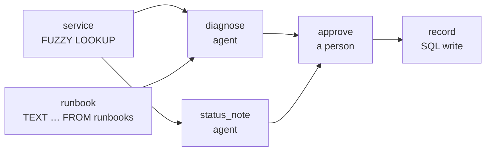
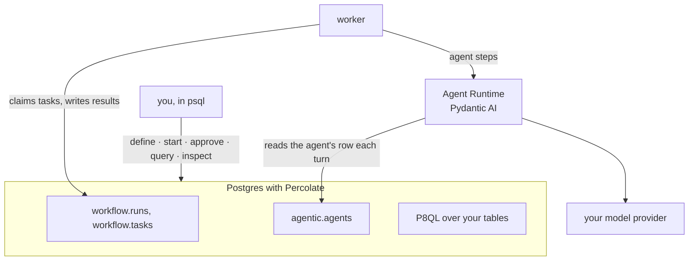

# Percolate

Percolate is a Postgres extension for AI workflows and agent memory. Agents, workflows, their runs and the documents
they read are rows, and you drive all of it with SQL. A worker and an agent runtime sit underneath and do the calling
out, but the place you define, start, approve, query and inspect everything is one Postgres connection.

**Documentation: <https://percolation-labs.github.io/get-percolate>**

1. **Install it.** Pick one of three ways in. All of them run the same release.
   - [Docker Compose](https://percolation-labs.github.io/get-percolate/install.html#docker-compose): the whole stack
     on one machine. The hello world below uses this.
   - [Kubernetes, with Helm](https://percolation-labs.github.io/get-percolate/install.html#helm): a plain chart with
     no CRDs, so Flux and Argo CD take it as it is.
   - [Into your own PostgreSQL 19](https://percolation-labs.github.io/get-percolate/install.html#into-a-postgres-19-you-already-run):
     the two extensions, installed into a database you already run.
2. If you use LangGraph and want durable workflows and agents in SQL, read
   [Percolate for LangGraph users](TODO-link-percolate-for-langgraph-users).
3. If you use Mem0 and want agent memory built from conversations and documents, read
   [Percolate for Mem0 users](TODO-link-percolate-for-mem0-users).
4. If you use Zep and want dated memory you can read as of any day, read
   [Percolate for Zep users](TODO-link-percolate-for-zep-users).
5. If you want to go from a remembered fact to the questions it bears on, read
   [From a remembered fact to the question it bears on](TODO-link-advanced-memory).
6. If you want every query mode and workflow step in one place, read the
   [P8QL](https://percolation-labs.github.io/get-percolate/grammar-p8ql.html) and
   [workflow](https://percolation-labs.github.io/get-percolate/grammar-workflow.html) references.

## Hello world

You'll build a small incident desk. An alert names a service and a symptom. The workflow finds the service and the
runbook lines that match the symptom with P8QL, then two agents work in parallel: one diagnoses, one drafts a note for
customers. A person approves the fix, and the decision is written to a table. You'll start it with the agent runtime
switched off, watch the agent steps fail and retry, switch it back on, and watch the run finish where it left off.



Everything is driven from psql. The worker claims each task that needs the outside world, and the Agent Runtime, a
thin layer over [Pydantic AI](https://ai.pydantic.dev), runs each agent turn. Neither holds any state of its own:
the run is rows the whole way through, which is why it survives either of them going away.



### Start the stack

You need Docker and `psql`. Make a directory, fetch the compose file and give it your OpenAI key. Any provider
[Pydantic AI supports](https://ai.pydantic.dev/models/) works: put its key in `.env` in the same way, such as
`ANTHROPIC_API_KEY`, and name its model in the agent rows below.

```bash
mkdir hello-percolate && cd hello-percolate
curl -fsSL https://raw.githubusercontent.com/Percolation-Labs/get-percolate/main/compose/docker-compose.yml \
  -o docker-compose.yml
cat > .env <<'EOF'
COMPOSE_PROJECT_NAME=hello-percolate
OPENAI_API_KEY=sk-your-key
EOF
docker compose up -d --wait
```

This runs Postgres 19 with both extensions, the worker, the Agent Runtime and the services around them. If port 5432
is taken, add `P8_PG_PORT=5433` to `.env` and use that port below.

Open psql from the same directory, so its `\!` commands can reach the stack:

```bash
psql postgres://p8:p8@localhost:5432/percolate
```

Every block from here on runs in that psql session.

### Sign in

Create the first user, then tell this session who you are. Workflows and agents run as the person who started
them, under the same row policies as everything else.

```sql
select rbac.bootstrap_admin('me@example.com', 'a long passphrase');
select set_config('request.jwt.claims',
         json_build_object('sub', (select id from rbac.users where email = 'me@example.com'))::text,
         false) is not null as signed_in;
```

### Your data, and P8QL over it

The desk's data is two ordinary tables: the services you run and the runbook lines your team has written.

```sql
create schema desk;
create table desk.services (id uuid primary key default gen_random_uuid(), name text not null unique);
create table desk.runbooks (id uuid primary key default gen_random_uuid(), service text not null,
                            content text not null);
create table desk.incidents (id bigint generated always as identity primary key, service text not null,
                             decision jsonb not null, decided_at timestamptz not null default now());
grant usage on schema desk to authenticated;
grant select on desk.services, desk.runbooks to authenticated;
grant insert on desk.incidents to authenticated;

insert into desk.services (name) values ('content-server'), ('object-store'), ('search');
insert into desk.runbooks (service, content) values
  ('content-server', 'Uploads hang: the content server cannot reach the object store. Check the object store, then restart the content server.'),
  ('object-store',   'Writes fail with 507: the object store is full. Expire old artifacts, then grow the volume.'),
  ('search',         'The first search after a restart is slow while the embedding model loads.');
```

Two calls make them searchable. The first makes each service a name you can look up, typos and all. The second
gives the runbooks a full-text index. Neither copies your rows.

```sql
select aiq.register_entity_table(p_entity_type => 'service', p_source_table => 'desk.services',
                                 p_key_expr => 'n.name');
select aiq.register_lexical_source('runbooks', 'desk.runbooks', 'content');
```

P8QL is the query language over all of it. You can run it at any moment, and the same query works inside a
workflow step:

```sql
select r->>'key' as service, r->>'score' as score
  from jsonb_array_elements(aiq.query('FUZZY LOOKUP "content server" LIMIT 1')->'rows') r;

select r->>'content' as runbook
  from jsonb_array_elements(aiq.query('TEXT "uploads hang" FROM runbooks LIMIT 3')->'rows') r;
```

`content server` finds `content-server`, and the runbook search finds the line about uploads.
`select aiq.query('SCHEMA');` lists every mode and source this database has. An agent given P8QL as a tool starts
there, and the [agents guide](https://percolation-labs.github.io/get-percolate/agents.html) shows how to give it one.

### Two agents, as rows

An agent is a row: its model, its prompt and its tools are columns. Changing one is an `UPDATE`, and the next turn
uses it, with nothing to redeploy.

```sql
select (agentic.upsert_agent(jsonb_build_object(
          'name', name, 'model', 'openai:gpt-4o-mini', 'system_prompt', prompt))).name
from (values
  ('diagnoser', 'You are the on-call engineer. From the alert and the runbook lines you are given, say in two '
                'sentences what is most likely wrong and the first thing to do.'),
  ('notifier',  'Write a two-sentence status note for customers about the incident you are given. '
                'Plain words, no blame, and no promise of a time.')) a(name, prompt);
```

### The workflow

A workflow is a YAML document that compiles to rows. `needs` says what each step waits for, so steps with nothing
in common run at the same time: `diagnose` and `status_note` here. `p8ql:` steps run inside Postgres, `agent:`
steps go to the Agent Runtime, and `signal: true` waits for a person.

```sql
select workflow.define_yaml($y$
name: incident
steps:
  - id: service
    p8ql: 'FUZZY LOOKUP "{{run.service}}" LIMIT 1'
  - id: runbook
    p8ql: 'TEXT "{{run.symptom}}" FROM runbooks LIMIT 3'
  - id: diagnose
    needs: [service, runbook]
    agent: diagnoser
    input: 'Alert on {{steps.service.result.rows.0.key}}: {{run.symptom}}. Runbook lines: {{steps.runbook.result.rows}}'
  - id: status_note
    needs: [service]
    agent: notifier
    input: '{{steps.service.result.rows.0.key}} is degraded: {{run.symptom}}'
  - id: approve
    needs: [diagnose, status_note]
    signal: true
  - id: record
    needs: [service, approve]
    sql:
      statement: "insert into desk.incidents (service, decision) values ('{{steps.service.result.rows.0.key}}', '{{steps.approve.result}}'::jsonb)"
      write: true
$y$);
```

### Run it, and break it

Stop the Agent Runtime:

```sql
\! docker compose stop agent
```

Then start the run. `\gset` keeps its id in `:run` for the rest of the session:

```sql
select workflow.start_workflow('incident', '{"service": "content server", "symptom": "uploads hang"}') as run \gset
```

The two P8QL steps finish inside that statement. The agent steps can't reach the runtime, so they fail, and each
failure puts the task back with a longer wait before the next attempt:

```sql
select pg_sleep(8);
select step_key, status, attempts, left(error->>'error', 50) as error
  from workflow.tasks where run_id = :'run' order by created_at;
```

`diagnose` and `status_note` show `ready` with two or three attempts and `connection failed`. Bring the runtime
back, and give the next attempt a moment:

```sql
\! docker compose start agent
```

```sql
select pg_sleep(15);
select step_key, status, attempts, left(output->>'result', 70) as result
  from workflow.tasks where run_id = :'run' order by created_at;
```

Both agent steps have now succeeded on a later attempt, and their answers are in `result`. The steps that
had finished were not run again, and the run went on from its rows. `approve`
reads `waiting_external`. It waits like this for an hour or a month with nothing running, and a restart of the whole
stack doesn't disturb it.

### Approve it

Read what the agents said, then sign off:

```sql
select step_key, output->>'result' as said
  from workflow.tasks where run_id = :'run' and step_key in ('diagnose', 'status_note');

select workflow.signal_task(:'run', 'approve', '{"decision": "restart content-server", "by": "me"}');
```

`signal_task` returns 1, the number of waiting steps it answered. The approval is a write made as you, so it is
refused for anyone who may not sign this run. The last step lands the decision in your table:

```sql
select status from workflow.runs where id = :'run';
select service, decision->>'decision' as decision, decided_at from desk.incidents;
```

### What happened is a query

The run's whole history is rows, so the trace is a `select`, and it joins with anything else in the database:

```sql
select step_key, kind, status, attempts,
       to_char(completed_at - (select created_at from workflow.runs where id = :'run'), 'SS.MS') as done_after_s
  from workflow.tasks where run_id = :'run'
 order by completed_at nulls last;
```

From here, the [workflow guide](https://percolation-labs.github.io/get-percolate/first-workflow.html) covers
fan-out over query results, timers, undoing work when a later step fails and scheduled runs, and the
[agents guide](https://percolation-labs.github.io/get-percolate/agents.html) covers tools, delegation and streaming.

## The source

| path | what it is |
|---|---|
| `extension/percolate` | the `percolate` extension: pure SQL, installable by a non-superuser so row-level security is real |
| `extension/percolate_parser` | the `percolate_parser` extension: the compiled parsers, in Rust with [pgrx](https://github.com/pgcentralfoundation/pgrx) |
| `specs/*/*.sql` | the schema the extension is generated from, one directory per subsystem |
| `core/` | a read-only mirror of percolate-core, the Python worker, Content Server and Agent Runtime. Change it in percolate-core: the next sync overwrites changes made here |
| `dev/` | the image build, the install CI runs, the tests and the upgrade gates |

The images are `percolationlabs/percolate-postgres` and `percolationlabs/percolate-core` on Docker Hub, the Python
package is `percolate-core` on PyPI, and the extensions and the Helm chart are published with each
[get-percolate release](https://github.com/Percolation-Labs/get-percolate/releases).

## Building and testing

The Postgres image, with the parser compiled from this tree (Docker with at least 6 GB of memory):

```bash
pip install pyyaml
REBUILD_PARSER=1 TAG=percolate-postgres:mine dev/build-image.sh
```

The extension installed as CI installs it, in a container of its own, then every gate CI runs:

```bash
IMAGE=percolate-postgres:mine CONTAINER=p8-mine DB=p8mine dev/ci-database.sh
CONTAINER=p8-mine DB=p8mine dev/check.sh
```

[CONTRIBUTING.md](CONTRIBUTING.md) lists what you need and how long each step takes.
`extension/percolate/sql/percolate--<version>.sql` is generated: edit `specs/`, then run
`python3 extension/percolate/build-sql.py`.

## The earlier Percolate

The Python project that used this name until October 2026 (`percolate-db` on PyPI) is now
[percolate-experiment](https://github.com/Percolation-Labs/percolate-experiment), with its full history.

## Licence

MIT. See [LICENSE](LICENSE).
