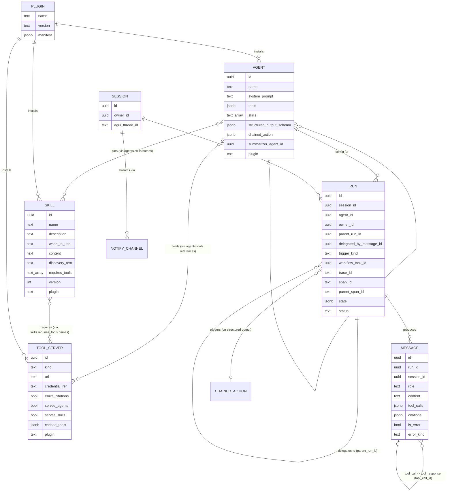

# Agentic — minimum ontology

## What each node means

- **AGENT** — a config row: prompt, tools, optional structured-output schema,
  optional `chained_action`. `tools` *references* `TOOL_SERVER` rows (`brief.md`
  §5.2), never embeds raw URLs/config or inline code — the agent runtime has no
  built-in tools of its own, so an agent's entire tool surface is whatever
  `TOOL_SERVER`s it points at. `summarizer_agent_id` self-references another
  `AGENT` row — the "who summarizes" question (`brief.md` §3) is itself just
  data, defaulting to one system-wide summarizer when null. Adding an agent is
  an insert, or (`brief.md` §6) a migration produced from a code-authored
  definition.
- **SKILL** — a markdown procedure as a row (`plugins.md`): `description` is
  what a model reads to decide whether it needs this, `content` is what it
  reads once it has decided, and the two columns are the mechanism rather than
  a tidy-up — offering a thousand skills costs a thousand description lines and
  the bodies cost nothing until one is named. A skill has no url, no
  credential and no invocation target: if it needs to *do* something it is a
  `TOOL_SERVER`, and if it needs to be *weighed* it is world-model content.
  Reached two ways, and they are different mechanisms rather than two settings
  of one: `AGENT.skills` names the ones concatenated into the system
  instructions at invocation, while a `TOOL_SERVER` with `serves_skills` — the *skill gateway*,
  the same trick delegation uses — exposes one tool per skill so the model can
  load one itself. `discovery_text` (generated) is the only thing embedded;
  `skills` registers as an `ai-query-layer` semantic source, so discovery over
  a large population is a query rather than a second index.
- **PLUGIN** — provenance, not a new kind of thing: a name, a version, the
  manifest as applied, and a nullable `plugin` column on the three
  configuration tables. That column is what makes a bundle applied from one
  document removable as one — `agentic.apply_plugin` upserts what the manifest
  declares and prunes what it no longer does, refusing to remove anything
  another agent still pins, binds, or has runs against.
- **TOOL_SERVER** — one registered MCP server or OpenAPI service, registered
  *once* and referenced by every agent that uses it, not duplicated per agent
  (`brief.md` §5.2). One of these rows is the runtime's own **agent gateway**:
  the MCP server exposing this runtime's agents as tools, which is how
  delegation stays an ordinary tool reference instead of a built-in tool.
  `emits_citations` marks a server whose responses are citable retrieval
  results, so §5.3's derivation is data-driven rather than a naming convention.
  `serves_skills` marks the skill gateway for a sharper reason than either:
  what that server returns is instructions, not an observation, so the
  persistence adapter has to be able to recognise it and stop windowing it away
  (`plugins.md` §7). `cached_tools` is the synced tool/operation list a
  scheduled `workflow-engine` task keeps fresh — an OpenAPI operation and an
  MCP tool are normalized into the same shape here, so nothing downstream of
  this table needs to know which `kind` a given tool came from.
- **SESSION** — one AG-UI thread; owns access control (`owner_id`, RLS-scoped).
- **RUN** — one agent invocation. `owner_id` is its own column rather than a
  join through `SESSION`, because a scheduled run has no session and would
  otherwise fall outside RLS entirely (`brief.md` §3). Self-referencing `parent_run_id` is what makes
  delegation a queryable tree instead of an in-memory call stack — `ai-query-layer`'s
  `GRAPH` mode can walk a delegation tree the same way it walks any other typed-edge
  graph. `trigger_kind` distinguishes an interactive run (has a `session_id`, streams
  via AG-UI) from a scheduled/background one (`workflow_task_id` points back at the
  `workflow-engine` task that created it — e.g. a periodic consolidation run). Both
  kinds are the same table, same `agents` config, same `messages` shape.
  `trace_id`/`span_id`/`parent_span_id` (W3C format, OTel ground rule) reuse
  `parent_run_id`'s tree directly — `parent_span_id` is just the parent run's own
  `span_id`, not a second thing to keep in sync.
- **MESSAGE** — turn content. `tool_calls` JSONB covers the fast path; explicit
  `tool_call`/`tool_response` message rows (self-referential) cover the slow path,
  used whenever a tool call is itself a delegated run — `tool_response` rows carry
  `is_error`/`error_kind` (`brief.md` §5.2). `role = 'summary'`
  (`brief.md` §3) is a third kind: not a turn at all, a single row per session
  the persistence adapter injects at the tail of the reloaded window,
  superseded (not appended to) each time the summarizer reruns. `citations`
  (`brief.md` §5.3) is populated on assistant messages only, derived by the
  runtime from that turn's `tool_response` rows, not authored by the LLM.
- **CHAINED_ACTION** — not a table, a reference: when an agent's structured output
  matches its schema, `chained_action` names a Postgres function (or PostgREST/
  webhook target) to call automatically, with both the call and its result persisted
  as message rows. For a consolidation run this is how the result actually lands —
  the chained action writes new `aiq.nodes`/`aiq.edges` rows into `ai-query-layer`'s tables,
  not a table owned by this system.
- **NOTIFY_CHANNEL** — not a table either: the Postgres `NOTIFY` channel a session
  streams deltas on, relayed by the FastAPI SSE bridge as AG-UI events.

## Which part of a turn's context each node supplies

`brief.md` §5.0 names the five components of the context a model receives.
`AGENT` and `SKILL` supply the **system instructions**. `SESSION`, `RUN` and
`MESSAGE` supply the **conversation state and history**, including the
`role = 'summary'` row. `TOOL_SERVER` supplies the **tool definitions**, and
`MESSAGE` records the **tool outputs** — `tool_calls` JSONB, or
`tool_call`/`tool_response` rows for a delegation. **Retrieved knowledge** and
**memory systems** have no node here: both live in `ai-query-layer`'s and
`world-model-ingestion`'s tables, and reach a turn through a `TOOL_SERVER`
flagged `emits_citations`.

## What's deliberately left off this diagram

The agent runtime itself (`brief.md` §5 — the declarative, tool-free
pydantic-ai process), the LLM API call, and the actual OpenAPI/MCP
microservices each `TOOL_SERVER` row points at — all of that lives outside
Postgres entirely. This ontology is the contract the runtime is built against
and reads/writes through, not the runtime's own internals or the tool
microservices it calls.
