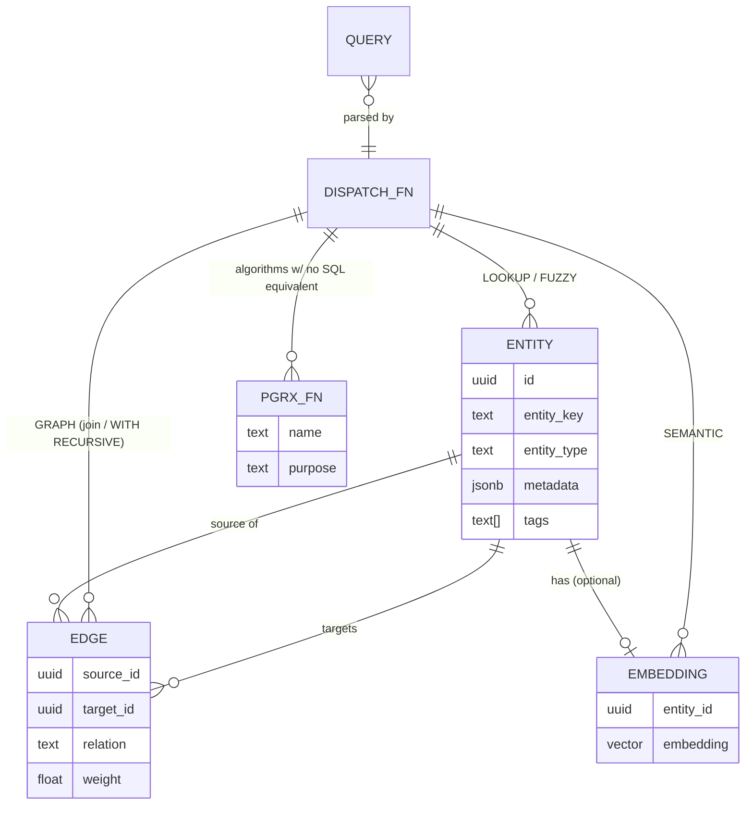

# AI Query Layer — minimum ontology

The smallest set of things you need to hold in your head to understand how a query
flows through this system.

`ENTITY`/`EDGE` below are the simplified names for this diagram's purposes.
`graph-identity.md` is the precise schema: `ENTITY` here is really two things —
each consumer's own typed table (attributes) plus its `nodes`/`node_keys` rows
(identity, lookup) — and `EDGE` here is `graph-identity.md`'s `edges` table
(soft, authored links only; hard FK/junction relationships are not `EDGE` rows
and don't appear on this diagram at all). Read `graph-identity.md` before
implementing against this ontology; this diagram is the mental model, not the
DDL.

## What each node means

- **ENTITY** — any queryable thing (a resource, a moment, an agent session, a
  world-model event). Every entity type shares the envelope (id, key, type,
  metadata, tags) so the same query modes work across all of them.
- **EDGE** — a typed, weighted relationship between two entities (`links_to`,
  `builds_on`, `mentions`, `delegates_to`, whatever a producing system defines).
  Edges are ordinary rows, not a JSONB blob — which is why removing the SQL/PGQ
  property graph once declared over them (it left PostgreSQL 19 before GA) cost
  one query and no migration.
- **EMBEDDING** — optional per-entity vector, one companion table per entity type,
  populated asynchronously after ingest.
- **DISPATCH_FN** — the single `aiq.query()` entry point (exposed via PostgREST RPC)
  that parses a query string's mode keyword and routes to the right mechanism.
- **PGRX_FN** — a `pgrx`-compiled Rust function for the handful of graph algorithms
  Postgres has no native operator for. Called by `DISPATCH_FN` like any other SQL
  function; invisible to the caller which mode is "native SQL" vs. "compiled Rust."

## What's deliberately left off this diagram

Per-entity-type schemas (`resources`, `moments`, `world-model events`, ...) — those
belong to the systems that own that data (`world-model-ingestion`, `agentic`, etc.).
This system's ontology is about the *query mechanism*, not every entity type it can
query.
