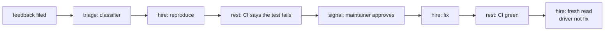

# A workflow hires an agent for a step

**Status: proposed, 19 October 2026. Not built.** The decisions in §4 are
proposals, each marked with its entropy and door; a card that builds one records the choice. Related: the
judgement queue (REM-1055) and the user's own agent as judge (REM-1056), which this generalises.

## 1. The idea

Today a workflow's model steps call Percolate core's own agent (`agent: <name>`, the Agent Runtime). This adds a step
that **waits on an outside agent**, the way `signal:` waits on a person. When the run reaches it, it parks a task
with a contract: what to do, what to read, and the shape the result must take. Any connected coding agent (Claude
in a coding session, Codex, a scheduled routine) claims it through MCP with a lease and a heartbeat, does the work
with its own tools (shell, repository, sandbox), and completes it. The database checks the result against the
contract before the run advances.

It is pull, not push. An agent cannot be woken, so a hired step waits for the next session that looks, or for a
routine that polls on a schedule.

The usual arrangement is inverted: normally the agent orchestrates and tools serve it. Here the workflow
orchestrates and hires an agent for one step.

**Why not let the agent run the whole process.** It can, but then the process lives in one context window. It ends
with the session; nothing enforces it, so a skipped approval goes unnoticed; only one driver can work on it, so
Codex cannot pick up halfway; and it cannot learn, because each run starts from zero. With Percolate holding the
workflow, a step is a rule: the database will not advance without the required result or approval, and the trace
is memory. After fifty runs we can ask which bugs keep coming back, which steps stall, and which driver gets
things wrong. Claude does the work; Percolate makes it a process a person can lead.

## 2. What the engine already has

Most of the mechanism exists. This is why the step is small.

| Needed | Exists | Where |
|---|---|---|
| park a task until somebody outside acts | `kind: work` on a named queue, `waiting_external` | `spec.md` §3–4, `YAML.md` step types |
| claim with a lease | `claim_task(queue, worker_id)`, `SKIP LOCKED` | `spec.md` §4 |
| heartbeat and stop | `heartbeat_task` → false on cancel, terminal or reaped | `spec.md` §4 |
| an expired claim returns to the queue | the reaper, `stale_timeout`, attempt cap | `failure-modes.md` §5 |
| a stale holder cannot complete | the lease fence on `worker_id` | `spec.md` §4, `schema.sql` §23 |
| the result has a declared shape | `output_schema`, checked in `complete_task` for any kind | `schema.sql` `complete_task`; `outputs.md` §3 |
| bytes as results (a patch, a log) | `register_artifact`, `$artifact` ids | `outputs.md` §4 |
| a step sees what the run's starter may see | steps read as starter | `YAML.md` § Whose rows a step sees |

`spec.md` §4 already says `claim_task` "is the same shape as a human claiming a piece of work in a marketplace" and
to reuse it rather than build bespoke claim logic. This spec follows that.

**What is missing.**

1. **Claiming as the caller.** `claim_task`, `heartbeat_task` and `complete_task` are granted to the `worker` role
   only, and `worker_id` is free text. A connected agent must claim as itself, under row policy, and the claim must
   record who it is.
2. **An MCP surface.** Core's MCP has no workflow tools.
3. **A YAML step** that says "an outside agent does this", with its contract.
4. **A driver constraint**, so a step can require a different driver from an earlier one.

## 3. The step

```yaml
- id: reproduce
  hire:
    brief: "Reproduce feedback {{run.feedback_id}} as a failing test in {{steps.triage.result.repo}}."
    reads: ["feedback:{{run.feedback_id}}", "repo:{{steps.triage.result.repo}}"]
    lease: 30m
    queue: hire:coding
    driver: {not: fix}            # optional: refuse a claim by the driver of step `fix`
  output_schema:
    type: object
    required: [test_path, commit, ci_run]
    properties:
      test_path: {type: string}
      commit:    {type: string, pattern: "^[0-9a-f]{7,40}$"}
      ci_run:    {type: string}
```

It compiles to `kind: work` on queue `hire:coding`, with `brief`, `reads`, `lease` and `driver` in the task input.
A claimer reads them through `get_task_context`. Nothing about execution is new.

## 4. Decisions

**a. The contract checks shape; a later step checks facts.** `output_schema` is the contract, as it is for every
other step. The database cannot run a test, so it never trusts an agent's word that a test fails. The fact is
checked by the next step, a `rest:` call to GitHub that reads the commit's check run and fails the run if the test
did not fail. *Entropy medium:* the alternative, an artefact type the engine knows ("failing test"), was live. It is
refused because it would teach the engine one forge's vocabulary. *Door:* two-way.

**b. The lease is per step, default 30 minutes, renewed by heartbeat.** An expired claim is reaped back to `ready`
by the existing reaper, and the late holder's completion is refused by the existing fence. A coding task can take
longer than a model call, so the lease is the step's own, not the queue's. *Entropy low. Door:* two-way.

**c. A driver is the authenticated caller, plus a label it declares.** A claim made through MCP records the
principal and the credential (a Codex connection has its own credential), and the client's self-declared label
(`claude-code`, `codex`, `routine`). Only the first two are trusted. *Entropy low:* `worker_id` stays the lease
token. *Door:* one-way once traces exist: the recorded fields become what history can be queried by.

**d. `driver: {not: <step>}` compares credentials.** A claim whose credential completed the named step is refused
at claim time, so the fresh read cannot be done by the agent that wrote the fix. Comparing labels would let any
client lie its way past it. *Entropy medium:* comparing principals was live, but one person's Claude and Codex
are the same principal, and the point is a different driver. *Door:* two-way.

**e. Who may claim is a grant, and what a claimer sees is the queue's own predicate.** A `hire:` queue is
claimable by holders of `workflow.hire:<queue>`. Which of its tasks a given claimer may see and claim is a
**per-queue claim visibility predicate**, over the caller and the task: a function, or a row policy the claim reads through. The default predicate is the
run's starter: the starter's own agents see the starter's runs. A queue may name another one. Starter scope is
wrong where runs start as the engine but the work belongs to someone else: dream's judgements are visible by
their subject node, so the `hire:judge` queue's predicate is that the caller can see the judgement row under its own row policy (§7). *Entropy medium:* starter-only
scope was live and is simpler, and it fails the first real queue. *Door:* one-way once granted to outside parties.
It follows [access rules live in Postgres](../user-rbac/).

**f. Routines find work by listing.** A tool lists claimable hired steps on the queues the caller may claim, oldest
first. A routine on a cron polls it. There is no push, and no notifier. *Entropy low. Door:* two-way.

## 5. Worked example: feedback to fix



A small local classifier triages (bug or feature, repository, severity) with no outside model. A coding session claims *reproduce*
and completes only with a failing test whose CI run the next step checks. A maintainer approves or declines. *fix* makes
the test pass. *fresh read* is claimable only by another credential, such as Codex. At the end the trace says who
triaged, reproduced, approved, fixed and checked, each with their reasons, and no orchestration code ran on a laptop.

## 6. Testing workflows with a swapped driver

The same mechanism tests workflows. A run driven through the production agent and the same workflow driven by
Claude can be compared step by step, because every step is recorded. Claude, reading as it executes, reports where
a step was ambiguous, a contract too loose, or where it had to guess: the postmortem's fresh reader, aimed at
workflows. It also forces every step to be a clear contract, since a workflow that runs only with the production
agent cannot be tested this way.

## 7. Relation to the judgement queue

REM-1055 queues dream's undecided judgements for a connected agent to claim and decide, with a reason recorded.
That is a hired step whose contract is a verdict. It is not a `hire:` queue yet, for two reasons recorded on
REM-1055 and above the judgement table in `specs/world-model-ingestion/graph.sql`:

1. `claim_task` belongs to the `worker` role until REM-1060, and the agent has to claim as itself today.
2. Visibility differs. A judgement is visible by its subject node (a private memory's candidate is its owner's),
   while dream's runs start as the engine, so starter scope would show every owner's names to any claimer, or none.

**Convergence.** Once REM-1060 lands with §4 e's per-queue predicate, the judgement queue becomes `hire:judge`
with the judgement row's own policy as its claim predicate: `judgements_via_subject` admits the subject node, or
once a bind is decided its target, both read through `aiq.nodes` as the caller. The calls are SECURITY INVOKER (the
gates refuse a user-reachable SECURITY DEFINER in `aiq`), and a guard trigger allows only a judge's moves. A
predicate can therefore be a row policy the claim reads through, not only a function. The tool names (`claim_judgement`,
`release_judgement`, `complete_judgement`, `list_judgements`) stay, as names for that queue's operations, so the
merge is mechanical.

## 8. Not this

- pushing work to an agent, or waking one
- a forge-specific artefact type in the engine
- replacing `agent:` steps, which stay for work core's own runtime does

## 9. Surprises

- Expected to design a claim protocol. `claim_task`, the lease fence, the reaper and `output_schema` already
  exist; the gap is that only the `worker` role may call them, with an identity nobody checks.
- `spec.md` §4 asked for this reuse a month ago, for a marketplace that was never built.
