# Worker Pools — consumer-declared, manager-reconciled, KEDA-scaled

> `pools.sql` is not shipped in the extension; the data model is verified and
> the control loop is a proposal (§13).

## 1. What this adds, and what it deliberately does not

`spec.md` §8 states the intent — *"One Deployment + ScaledObject per queue …
YAML generated from declared queues, not hand-authored per zone"* — but names
neither where queues are declared nor what does the generating. This document
is both halves.

**The addition is one idea: a worker pool is a row.** A consumer declares an
image, a resource shape and scale bounds in `workflow.pools`; a manager process
reconciles those rows into Kubernetes Deployments and KEDA `ScaledObject`s; KEDA
scales each between 0 and N on that pool's queue depth. Nobody gets cluster
credentials to do it, and no YAML is authored per pool.

This is the same move the rest of the collection already makes — the database is
the control surface, and the process in front of it is a thin executor of what
the rows say. A pool declaration is not a
deployment manifest with a database in front of it; it is a row, and the manifest
is derived output that no human is expected to read.

**Not in scope, on purpose:**

- **Not a general-purpose Kubernetes control plane.** The manager reconciles two
  kinds (Deployment, ScaledObject) plus per-tenant namespace scaffolding. It does
  not become a way to run arbitrary workloads; a pool that needs an Ingress, a
  StatefulSet or a volume is not a pool.
- **Not a scheduler.** Which task goes to which pool is already decided by
  `tasks.queue` — a column that has existed since the first schema. Pools bind to
  queues; they do not route.

- **Not a replacement for `kind = 'sql'`.** Steps that run inside Postgres need no
  pool, no image and no pod (`schema.sql` §17), and `http_call` is already handled
  generically by the standard worker. **Pools exist for `kind = 'work'` with
  consumer code** — that is the entire population this serves, and it is worth
  checking a step actually belongs to it before declaring a pool for it.

---

## 2. The boundary: who owns what

Three parties, and the value of the design is that they share no credentials.

| Party | Writes | Never has |
|---|---|---|
| **Consumer** (a user, via SQL/PostgREST) | rows in `workflow.pools` | cluster access of any kind — no kubeconfig, no service account, no namespace |
| **Manager** (`percolate-core`, in-cluster) | Deployments and ScaledObjects in one namespace; `workflow.pool_status` | write access to `workflow.pools` — it may only read desired state |
| **Admin** | `workflow.pool_image_policy`, the namespace and its quota, the cluster | — |

The manager holding *no* write access to `pools` is the load-bearing half. It
means a compromised manager cannot rewrite desired state to make its own actions
look correct, and it means the desired/observed split is real rather than
cosmetic: drift is always the manager's fault or the cluster's, never a case of
desired state having quietly moved.

**One namespace.** Pools deploy into a single namespace the manager is
configured with — `P8_POOL_NAMESPACE`, default `percolate`. It is manager
configuration, never a column, and the manager **verifies it exists at startup
rather than creating it**. Both halves matter:

- A consumer-writable namespace is a direct route to scheduling a pod into
  `kube-system`. Keeping it out of the schema means there is no code path by
  which a namespace string arrives from a consumer — nothing to validate,
  because nothing is accepted.
- Creating namespaces is a cluster-scoped verb. Not needing it is why the
  manager's RBAC is a **`Role`**, not a `ClusterRole` — see §7.1, where the
  size of that difference is the main argument for this shape.


## 3. Data model

Four tables in the `workflow` schema. Full DDL in `pools.sql`.

### 3.1 `workflow.pools` — desired state, consumer-owned

```sql
create table workflow.pools (
    name          text primary key
                      check (name ~ '^[a-z0-9]([a-z0-9-]{0,38}[a-z0-9])?$'),
    -- Set by trigger, not DEFAULT: a subquery is not legal in a DEFAULT
    -- expression. workflow.schedules hit this first and solved it the same
    -- way (set_schedule_owner), so this gets that shape rather than a second.
    -- FK to rbac.users matches workflow.runs.owner_id -- without it a deleted
    -- user leaves pools nobody can edit under RLS but which the manager
    -- happily keeps reconciling.
    owner_id      uuid references rbac.users(id),
    image         text not null,
    command       text[] not null default array['worker'],
    min_replicas  int  not null default 0  check (min_replicas >= 0),
    max_replicas  int  not null default 10 check (max_replicas >= 1),
    cpu_request   text not null default '100m',
    cpu_limit     text not null default '1',
    mem_request   text not null default '256Mi',
    mem_limit     text not null default '1Gi',
    node_class    text not null default 'standard'
                      check (node_class in ('gpu','highmem','standard')),
    tasks_per_replica int not null default 1 check (tasks_per_replica >= 1),
    drain_seconds int  not null default 300 check (drain_seconds between 30 and 3600),
    env           jsonb not null default '{}',   -- non-secret only, filtered (§7.3)
    secret_refs   text[] not null default '{}',  -- k8s Secret NAMES in the pool's own namespace
    enabled       boolean not null default true,
    generation    bigint not null default 1,
    created_at    timestamptz not null default now(),
    updated_at    timestamptz not null default now(),
    check (max_replicas >= min_replicas)
);
```

Deliberately absent columns, each for a reason that matters:

| Column a reader will look for | Why it is not there |
|---|---|
| `namespace` / `tenant` | Manager configuration (`P8_POOL_NAMESPACE`), never row data. A writable namespace column is a direct path to scheduling a pod into `kube-system`; §2. |
| `replicas` | KEDA owns replica count. A desired-state row that also names a replica count guarantees a fight with the HPA; §5.3. |
| `environment` / `cluster` | Each environment has its own Postgres cluster, so the rows *are* that environment's desired state; §8. |
| `dsn` / `database_url` | Injected by the manager from a Secret it controls. Consumer-supplied connection strings would let a pool connect as any role it could guess a password for; §7.3. |
| `queues` (as an array) | A separate table, so "exactly one pool serves a queue" is a primary key rather than a trigger; §3.2. |

### 3.2 `workflow.pool_queues` — the binding

```sql
create table workflow.pool_queues (
    queue text primary key,
    pool  text not null references workflow.pools(name) on delete cascade
);
```

`on delete cascade` is half of what makes deleting a pool complete: the row goes,
its queue bindings go, and its `pool_status` row goes. The other half is the
manager deleting the Deployment, which §4.3 covers — and which needs a NOTIFY on
`DELETE`, not just on write, or nothing tells the manager the pool is gone.

A primary key on `queue` enforces the invariant that matters — **at most one
pool serves a queue** — in the database rather than in the manager. Two pools
claiming the same queue is not a scaling strategy; it is two ScaledObjects
computing replica counts from a depth each of them is draining, which oscillates.

The reverse cardinality is open: one pool may serve several queues, and its
ScaledObject gets one trigger per queue. Default is 1:1, created automatically —
declaring a pool named `embed` binds queue `embed` unless rows say otherwise.

**One-pool-many-queues is a requirement on the worker, not just on the
renderer**, and it is not currently met: `percolate-core`'s worker takes a
single `--queue`, and the reference loop polls one. Multi-queue pools need the
claim loop to round-robin across its queues without letting a busy queue starve
a quiet one. Until that exists, the binding table is still correct and still
worth having — it is what enforces one-pool-per-queue — but every pool is 1:1
in practice. Called out here rather than discovered when the second binding row
produces a pool that silently serves only the first queue.

The `{step-group}:{resource-class}:{zone}` queue convention from `spec.md` §3 is
unchanged and still just a naming convention. `node_class` on the pool is what
now actually produces the affinity, rather than the manager parsing a segment out
of a queue name — the same information, declared instead of encoded.

### 3.3 `workflow.pool_status` — observed state, manager-owned

A separate table, not columns on `pools`, for two reasons. It keeps the grant
clean (the manager writes here and nowhere else, §2), and it structurally
prevents the reconcile loop's oldest bug: a status write that bumps `generation`
and so schedules the next reconcile that writes status again, forever.

```sql
create table workflow.pool_status (
    pool                text primary key references workflow.pools(name) on delete cascade,
    observed_generation bigint,
    ready_replicas      int,
    desired_replicas    int,
    phase               text not null default 'pending'
                            check (phase in ('pending','applying','ready','degraded','error')),
    message             text,
    last_applied_at     timestamptz,
    last_error_at       timestamptz,
    updated_at          timestamptz not null default now()
);
```

`observed_generation < generation` means the manager has not caught up.
`observed_generation = generation` with `phase = 'error'` means it caught up and
Kubernetes refused. Those are different problems and a single `status` column
cannot tell them apart, which is the whole argument for carrying the pair.

### 3.4 `workflow.pool_image_policy` — the registry allow-list

```sql
create table workflow.pool_image_policy (
    id       bigint generated always as identity primary key,
    pattern  text not null unique,          -- glob, e.g. 'ghcr.io/acme/*'
    note     text,
    added_by uuid references rbac.users(id),
    added_at timestamptz not null default now()
);
```

Checked by a trigger on `pools`, so a disallowed image fails at `INSERT` with a
comprehensible error rather than as an `ImagePullBackOff` a consumer cannot see.
An empty table means no pool may be declared at all — deny by default, because
the failure mode of the other default is running an arbitrary image from an
arbitrary registry inside the cluster.

Flat rather than per-consumer: with one namespace there is one trust boundary,
and a per-consumer allow-list would be pretending otherwise. It becomes
per-tenant if and when namespaces do (§11).

---

## 4. The manager

### 4.1 It is `percolate-core`, not a new service

**Partly built.** A fifth subpackage alongside `core`, `worker`, `content` and
`agentic`, following the way the others compose. `percolate_core/manager/`
exists and `pool render` works; `diff` and `run` are stubs that say so, and the
`router()` and `lifespan()` below are not written yet. The design is a `router()`
(readiness plus a read-only pool status surface), a `lifespan()` that owns the
Kubernetes client and the reconcile task, and the `pool` Typer group the parent
CLI mounts.

```
percolate pool run       # the reconcile loop (a stub today)
percolate pool render    # print what would be applied, apply nothing (built)
percolate pool diff      # render against live cluster state (a stub today)
```

**The subpackage is `manager`; the command group is `pool`.** The mismatch is
deliberate and follows the CLI naming rule: a command names the thing
being operated on, not the process that implements it. An operator reconciles
pools, and `manager` is the answer to a question they did not ask.

```bash
pip install 'percolate-core[manager]'   # + kubernetes-asyncio
```

It mounts the way every other subpackage does: `percolate_core/manager/`
exporting a Typer `app`, picked up by `cli.py`'s `_subcommands()` — the same
lazy-import path that lets `pip install percolate-core` stay worker-only. A
missing `kubernetes_asyncio` then reports as "install the `manager` extra"
rather than as a crash, which is machinery that already exists and needs
nothing added for a fourth command.

**Why not a separate image.** The same argument percolate-core's packaging
already makes for one image with several commands: the manager shares `percolate_core.core`'s
connection, config and identity handling, and a fourth command costs a few
megabytes against a second build, a second tag and a second thing to keep in step.
Its dependency footprint is one Kubernetes client, which is exactly what an extra
is for.

**Why not a CRD and an operator-SDK operator.** A CRD would put desired state in
etcd — a second source of truth beside the table consumers already write, needing
sync in both directions. The table is the API. The check-precedent rule applies
to the manager itself: the loop is a poll, a diff and
an apply, which is a few hundred lines against a client library, and adopting an
operator framework to get it buys reconciliation machinery we would use one
percent of.

**`render` is not a convenience.** It is how a change to the generator gets
reviewed — the manifests in §5 are output, and output that nobody can see before
it is applied is output nobody reviews. A checked-in render belongs beside the
generator, so that a diff on the generator shows up as a diff in a pull request.

### 4.2 The loop

```
startup:
    verify namespace P8_POOL_NAMESPACE exists  -- do not create it; exit if absent
    acquire pg_try_advisory_lock(hashtext('workflow.pool_manager'))  -- or exit
    LISTEN p8_pool_changed

loop:
    wait for NOTIFY, or resync_interval (default 30s), whichever first

    desired := select * from workflow.pools where enabled
    actual  := list Deployments in ns labelled app.percolate/managed-by=manager

    for each pool in desired:
        server-side apply Deployment      (fieldManager: percolate-manager)
        server-side apply ScaledObject    (fieldManager: percolate-manager)
        report_pool_status(pool, generation, phase, ready, desired, message)

    for each name in actual - desired:          -- deleted, or disabled
        delete ScaledObject, then Deployment
```

The last block is not a housekeeping step. It is the other half of the feature:
**a pool row that goes away must take its Deployment with it.** A reconciler
that only creates is a reconciler that leaks workloads — and leaked pool
workloads are worse than leaked pods generally, because they hold a database
connection and keep claiming tasks off a queue nobody thinks is being served.

Deleting the ScaledObject **before** the Deployment matters and is easy to get
backwards. KEDA removes the HPA when its ScaledObject goes; delete the
Deployment first and there is a window where an HPA targets a workload that no
longer exists, which KEDA logs about continuously. Order it the other way and
the window does not exist.

Set-difference against live cluster state, not a delete driven by the
notification, is what makes this converge. A `DELETE` fires a NOTIFY (§3.2) so
the manager wakes immediately rather than up to a resync interval later — which
matters, because the reason people delete pools is usually that they want them
to stop — but the *decision* to delete comes from comparing what exists against
what is declared. A manager that acted on notification payloads alone would
leak a Deployment for every notification it missed while restarting.

**Singleton by advisory lock, not by a lease.** A rolling update of the manager
briefly runs two pods; two reconcilers doing server-side apply against the same
objects is survivable but produces confusing status churn, and the prune step is
genuinely unsafe concurrently. Kubernetes' answer is a `Lease` and leader
election; ours is `pg_try_advisory_lock` on a connection the manager already holds
— zero new machinery, released automatically when the connection dies, which is
precisely the semantics leader election exists to provide. This is the same
check-precedent rule that produced `claim_task` rather than a queue service.

**Server-side apply, not create-or-patch.** Field ownership means a `kubectl edit`
against a managed Deployment is reverted on the next resync without the manager
having to detect that it happened, and a field the manager stops sending is
removed rather than orphaned.

**NOTIFY is an optimisation; the resync is the correctness mechanism.** A missed
notification costs latency, not convergence. The channel is namespaced
`p8_pool_changed`, so it cannot collide with another module's channel.

### 4.3 Deletion is label-scoped, and `enabled = false` is the same path

The manager deletes only objects carrying `app.percolate/managed-by=manager`, and
only in its configured namespace. Both conditions, not either. An unlabelled
Deployment in that namespace is left alone and reported, because the alternative
— a reconciler that deletes what it does not recognise — turns one bad label
selector into an outage, and the namespace is shared with the manager itself.

`enabled = false` and a deleted row take the identical path: both drop out of
the desired set, so both get their Deployment removed. The difference is only
what survives in Postgres — a disabled pool keeps its row, its queue bindings
and its status history, so re-enabling it is one `UPDATE` and the manager brings
it straight back. **`enabled = false` is the reversible stop; `DELETE` is the
permanent one.** Worth knowing which you want before typing, since a delete also
takes the `pool_queues` rows that recorded what the pool was for.

Neither drains gracefully by itself. Removing the Deployment sends SIGTERM to
its pods, which is the ordinary drain path (§6.3) — tasks in flight get
`drain_seconds` to finish. Tasks still `running` when a pod is finally killed
are reaped back to `ready` by `stale_timeout`, and then sit unclaimed, because
the pool that would have claimed them no longer exists. That is correct and it
is also a trap: **deleting a pool with a deep queue silently strands that
queue's work.** `v_unserved_queues` is what surfaces it afterwards (§10); the
manager does not refuse the delete, because refusing to stop something is worse
behaviour in an incident than stranding work you can see.

The manager is also granted no verb on `secrets` at all. It writes the worker
DSN into a pod spec **by reference**, which needs no ability to read the value —
so a compromised manager cannot exfiltrate the credential it distributes.

---

## 5. What gets rendered

### 5.1 Deployment (one per pool)

```yaml
apiVersion: apps/v1
kind: Deployment
metadata:
  name: p8-pool-{{ pool.name }}
  namespace: {{ config.pool_namespace }}      # NOT from the row -- §2
  labels:
    app.percolate/managed-by: manager
    app.percolate/pool: "{{ pool.name }}"
    app.percolate/generation: "{{ pool.generation }}"
spec:
  # NO .spec.replicas -- see §5.3
  selector:
    matchLabels: { app.percolate/pool: "{{ pool.name }}" }
  template:
    metadata:
      # BOTH labels on the POD. The NetworkPolicy selects pool pods by
      # app.percolate/managed-by, and a label present only on the Deployment
      # selects nothing -- a pool whose pods quietly fall outside default-deny
      # egress, with everything appearing to work.
      labels:
        app.percolate/managed-by: manager
        app.percolate/pool: "{{ pool.name }}"
    spec:
      serviceAccountName: {{ config.pool_service_account }}
      automountServiceAccountToken: false
      terminationGracePeriodSeconds: {{ pool.drain_seconds }}
      securityContext:
        runAsNonRoot: true
        runAsUser: 65532
        seccompProfile: { type: RuntimeDefault }
      {{#if pool.node_class}}
      nodeSelector:  { percolate.io/node-class: "{{ pool.node_class }}" }
      tolerations:
        - key: percolate.io/node-class
          operator: Equal
          value: "{{ pool.node_class }}"
          effect: NoSchedule
      {{/if}}
      topologySpreadConstraints:
        - maxSkew: 1
          topologyKey: kubernetes.io/hostname
          whenUnsatisfiable: ScheduleAnyway
          labelSelector:
            matchLabels: { app.percolate/pool: "{{ pool.name }}" }
      containers:
        - name: worker
          image: "{{ pool.image }}"
          command: {{ pool.command }}
          args: [ {{#each pool.queues}}"--queue", "{{this}}",{{/each}} ]
          securityContext:
            allowPrivilegeEscalation: false
            readOnlyRootFilesystem: true
            capabilities: { drop: ["ALL"] }
          resources:
            requests: { cpu: "{{ pool.cpu_request }}", memory: "{{ pool.mem_request }}" }
            limits:   { cpu: "{{ pool.cpu_limit }}",   memory: "{{ pool.mem_limit }}" }
          env:
            - name: P8_DSN
              valueFrom:
                secretKeyRef: { name: p8-worker-dsn, key: dsn }   # manager-owned, §7.3
            - name: P8_WORKER_ID
              valueFrom: { fieldRef: { fieldPath: metadata.name } }
            {{#each pool.env}}
            - name: "{{@key}}"
              value: "{{this}}"
            {{/each}}
          envFrom:
            {{#each pool.secret_refs}}
            - secretRef: { name: "{{this}}" }
            {{/each}}
```

### 5.2 ScaledObject (one per pool, one trigger per bound queue)

```yaml
apiVersion: keda.sh/v1alpha1
kind: ScaledObject
metadata:
  name: p8-pool-{{ pool.name }}
  namespace: {{ config.pool_namespace }}
  labels: { app.percolate/managed-by: manager, app.percolate/pool: "{{ pool.name }}" }
spec:
  scaleTargetRef: { name: p8-pool-{{ pool.name }} }
  minReplicaCount: {{ pool.min_replicas }}
  maxReplicaCount: {{ pool.max_replicas }}
  pollingInterval: 15
  cooldownPeriod: {{ pool.drain_seconds }}
  fallback:
    failureThreshold: 3
    replicas: {{ max(pool.min_replicas, 1) }}
  triggers:
    {{#each pool.queues}}
    - type: postgresql
      metadata:
        query: "select workflow.queue_depth('{{this}}')"
        targetQueryValue: "{{ ../pool.tasks_per_replica }}"
        activationTargetQueryValue: "0"
      authenticationRef:
        name: p8-keda-postgres
        kind: ClusterTriggerAuthentication   # cluster-scoped -- see below
    {{/each}}
```

**`ClusterTriggerAuthentication`, not `TriggerAuthentication`** — and the reason
for that changed when this design collapsed to one namespace, which is worth
recording because the conclusion surviving a change of premise is usually worth
re-checking rather than assuming.

The original argument was distribution: with a namespace per tenant, a
namespaced `TriggerAuthentication` and its Secret would have to be copied into
every namespace the manager created. That argument is gone — every ScaledObject
now lives in one namespace, so a namespaced one would work.

What keeps it cluster-scoped is the opposite direction. That namespace is where
**consumer images run**, and any pool may name any Secret in its own namespace
(§7.3). A scaler credential placed there would be readable by every pool.
Cluster-scoped keeps it in KEDA's namespace, which no pool can reach. The
credential is low-value by construction — `keda_scaler` can execute exactly one
function — so this is defence in depth rather than the thing standing between a
pool and the database. It is still free.

`fallback` is not decoration. Without it, a database the scaler cannot reach reads
as "no metric", and a pool that should be draining a backlog sits at zero while
Postgres is the thing having the outage. Holding at the current floor is the
correct behaviour for an unknown depth.

### 5.3 The manifest must not carry `.spec.replicas`

KEDA scales the Deployment by creating an HPA against it. A manager that includes
`replicas` in what it applies will, on every resync, write back the number in the
row while the HPA writes the number it computed — a fight that presents as pods
flapping on a 30-second cycle and is consistently misdiagnosed as a scaling bug in
KEDA. Server-side apply makes the fix exact rather than a matter of care: the
field is never in the applied configuration, so the manager never claims ownership
of it.

This is the single most likely thing to be got wrong when this is implemented,
and the checked-in render (§4.1) exists partly so that its absence is visible
in review.

---

## 6. Scaling semantics

### 6.1 `queue_depth()` counts `running`, not only `ready`

**Where it lives:** `workflow-engine/schema.sql`, next to `workflow.tasks`, and
it ships in the extension. It was in `pools.sql` until the Helm chart in
`get-percolate` needed it with no manager and no pools table anywhere — an
autoscaler reading a queue is not a pool's concern, it is the queue's. The
argument for what it counts is still made here.

```sql
create or replace function workflow.queue_depth(p_queue text)
returns bigint as $$
    select count(*) from workflow.tasks
    where queue = p_queue
      and (status = 'running'
           or (status = 'ready' and run_after <= now()));
$$ language sql stable;

-- and, with the other definer functions further down:
alter function workflow.queue_depth(text)
    security definer set search_path = workflow, pg_catalog;
```

The obvious implementation counts claimable work — `status = 'ready'` — and is
wrong in a way that only appears under long tasks. A pool of ten pods each three
minutes into a task reports depth 0, KEDA reads that as idle, and the pods are
scaled out from under work in flight.

Counting in-flight work fixes it and the arithmetic stays right, because KEDA's
target is *per replica*: N pods each holding one task report depth N against a
target of 1, which resolves to N. Work drains, `running` and `ready` both reach
zero, and the pool goes to zero — with no special case anywhere.

`run_after <= now()` is equally deliberate. A task backing off between retries is
not work anyone can do yet, and holding a pod for it burns money until the backoff
expires. Excluded, the pool scales to zero and KEDA reactivates it when the
timestamp passes.

The remaining inaccuracy is a task `running` on a pod that died, which inflates
depth until `reap_stale_tasks()` returns it to `ready` at
`queue_config.stale_timeout`. The bound is that timeout, the failure direction is
over-provisioning rather than dropped work, and both are the right way round.

### 6.2 Scale-to-zero, and the two thresholds

`activationTargetQueryValue` gates 0→1; `targetQueryValue` drives 1→N. They are
different questions — *is there any work?* and *how much work per pod?* — and
the failure mode is setting them to the same number. With a target of 5 and an
activation of 5, a queue holding three tasks never activates: it sits at zero
replicas with work waiting, indefinitely, and nothing reports an error because
nothing is wrong as far as KEDA is concerned.

Activation defaults to 0, so omitting it is safe; the render writes it
explicitly anyway, because a field that is invisible when correct is a field
nobody checks when it is wrong. **The rule is that activation is a
work-exists threshold and belongs at 0 unless there is a stated reason for a
pool to ignore small backlogs** — not a second copy of the target.

Nothing needs to be running for reactivation: at zero replicas KEDA itself polls
Postgres. That is a real cost — one connection per ScaledObject per
`pollingInterval` — which is why the scaler connects **through the pooler**, never
to the primary directly, and why `pollingInterval` has a floor of 15s. A few
hundred pools polling a primary directly every second is a denial of service
against your own database, delivered by your own autoscaler.

### 6.3 Draining

Scale-down sends SIGTERM. The contract the pool design depends on, and which
`percolate-core`'s worker must honour:

1. SIGTERM → stop claiming new tasks.
2. Finish in-flight tasks, heartbeating throughout.
3. Exit.

`terminationGracePeriodSeconds` and `cooldownPeriod` both come from
`pools.drain_seconds` so they cannot drift apart. A task that outlives the grace
period is SIGKILLed, stops heartbeating, and is reaped back to `ready` by
`stale_timeout` — correct, at the cost of the work done so far, which is what
`heartbeat_task`'s cooperative-cancel return exists to let a long step avoid.

---

## 7. The security boundary

"A consumer points at a Docker image" means running code we did not write in our
cluster. Everything below is load-bearing; this is the list, not a selection from
it.

### 7.1 One namespace, and what that buys

Pools deploy into the namespace the manager is configured with, which the
manager verifies at startup and never creates (§2). The payoff is not
convenience — it is the size of the manager's grant.

An earlier draft created a namespace per tenant from table rows. Because
**Kubernetes RBAC cannot express "namespaces matching a prefix"** — a `Role`
binds to one named namespace, and names created at runtime cannot be enumerated
in advance — that version needed a cluster-wide `ClusterRole` over five resource
kinds, plus a `ValidatingAdmissionPolicy` to claw the scope back, plus a
Kubernetes ≥ 1.30 floor to have that policy at all.

Fixing the namespace deletes every line of that. What remains is two resource
kinds in one namespace: a `Role` and a `RoleBinding`. The manager is also granted no verb on
`secrets` at all — it writes the worker DSN into a pod spec **by reference**,
which needs no ability to read the value, so a compromised manager cannot
exfiltrate the credential it distributes.

The cost is that pools are not isolated from each other by namespace. Everything
in §7.4 still holds, but "another pool's namespace" is no longer among the
things a hostile pool cannot reach, because there is no other namespace. That is
the trade, and §11 records what changes if it stops being acceptable.

### 7.2 The namespace's guard rails, applied once by an admin

Applied once with the namespace, not generated per pool:

- **`ResourceQuota`.** `pools.sql` has no check constraints on
  `cpu_limit`/`mem_limit`, so a bad value surfaces when Kubernetes parses it;
  the quota is what actually stops a
  forged row, because it is evaluated by the API server against the sum of every
  pod in the namespace rather than by a trigger against one row. Shared across
  all pools, so one pool can starve another — the honest consequence of one
  namespace, and the reason `max_replicas` is a column worth setting rather
  than leaving at its default.
- **`LimitRange`** with a default and a maximum, so a pod that somehow omits
  resources gets bounded ones.
- **`NetworkPolicy`**, default-deny egress with an allow-list of exactly the
  connection pooler, the object store, and DNS. Not the Postgres primary —
  pools reach the database through the pooler like every other client. It
  selects pool pods by `app.percolate/managed-by`, so it constrains pools
  without constraining the manager, which does need the API server.
- **Pod Security Admission** at `restricted`, on the namespace, which is what
  makes a rendered pool's `securityContext` enforced rather than advisory.

Additional egress is an admin action against the cluster, never a column on
`pools`. A consumer-writable egress allow-list is a consumer-writable
exfiltration path, and the convenience does not pay for that.

### 7.3 Reserved environment keys

`pools.env` is merged into the container's environment **after** a filter that
rejects a reserved prefix — `P8_DSN`, `P8_SERVICE_ROLE`, `P8_ROLE`,
`P8_WORKER_ID`, and anything matching `P8_*_SECRET`. Enforced by a trigger on `pools`, so it fails at write
time, and again by the manager when rendering, because a filter that exists in one
place is a filter that gets bypassed the first time someone adds a second write
path.

The database credential is injected by the manager from a Secret the manager
controls, and it is the `worker` role — which holds **no table privileges at all**
(`specs/user-rbac/roles.sql` §4). Every interaction is a SECURITY DEFINER function
call. That property was already true and is what makes handing a consumer's own
image a live database connection a bounded decision rather than a reckless one:
the worst a hostile pool can do to the database is call `claim_task` and
`fail_task` in a loop.

`secret_refs` names Secrets **in the pool namespace**. A Deployment cannot mount
a Secret from another namespace — Kubernetes enforces that structurally, so
nothing a consumer writes here can reach a credential outside it. Within the
namespace it is not a boundary: any pool may name any Secret there, including
`p8-worker-dsn`. That is fine for the DSN specifically, since every pool is
handed it anyway, and it is the reason no *other* credential should be parked in
this namespace without meaning every pool to have it.

### 7.4 What a hostile pool still gets

Stated so it is a decision rather than an omission. It gets: the `worker` role's
function surface, and therefore the ability to claim and fail tasks on **any**
queue it asks for; the contents of the Secrets it references; network reach to
the pooler and the object store; and whatever it can take of the shared
namespace quota. It does not get: a service account token, cluster API access,
table reads, or egress anywhere else.

Two of those deserve attention rather than a footnote.

**Queue binding is a routing rule, not an authorisation boundary.** §3.2
guarantees at most one pool is *deployed* per queue; it does not stop a pool's
process from calling `claim_task('some-other-queue', …)`, because the `worker`
role's grant is per-function, not per-queue. So a hostile image can claim and
fail work belonging to any pool in the deployment. Making that a real boundary
means either a queue-scoped role per pool or a `claim_task` that checks the
caller against `pool_queues` — neither is specified here, and the honest
statement is that pools are isolated by *scheduling*, not by *authority*.

**The quota is shared.** One pool can consume the namespace's CPU and memory and
leave the others `Pending`. Bounded by `max_replicas` and the `LimitRange`
maximum, not eliminated.

Both are consequences of one namespace and one worker role — acceptable when
pools are declared by colleagues, and the first two things to fix if they are
ever declared by strangers (§11).

---

## 8. Environments

There is no environment column, and adding one is the wrong instinct.

The deployment shape is already one Postgres cluster per environment. `workflow.pools` in a cluster's database therefore *is* that
environment's desired state, and one manager per cluster reads only its own.
Staging seeds the same rows with `min_replicas = 0` and small `max_replicas`. Same
schema, same manager, same code path, three clusters, and no environment branching
anywhere in the generator — which is the property that makes staging worth
anything, since a staging environment that renders differently from production is
testing a thing that is not production.

What does differ per environment is the manager's own deployment: image tag,
resync interval, log level, which pooler. Kustomize overlays, which is the standard mechanism and needs no tooling we do not already have.

---

## 9. Roles and grants

Three roles, and the third is new.

| Role | Gets | Notes |
|---|---|---|
| `worker` | unchanged — SECURITY DEFINER functions only | `roles.sql` §4; pools change nothing about it |
| `pool_manager` | `SELECT` on `pools`/`pool_queues`; `EXECUTE` on `report_pool_status()` | **No write on `pools`** (§2) |
| `keda_scaler` | `EXECUTE` on `workflow.queue_depth(text)`. Nothing else. | Not the worker role — KEDA is cluster infrastructure and should not hold a credential that can claim work |

`keda_scaler` being separate is worth the extra role. The scaler's credential lives
in a `ClusterTriggerAuthentication` whose Secret sits in KEDA's own namespace; a
worker credential in that position would be a task-claiming credential in that
position.

Consumers reach `pools` as themselves under RLS, mirroring `workflow.schedules`
exactly: write is `owner_id = rbac.current_user_id()` or an explicit
`workflow_pools` permission.

**Read is deliberately wide — every authenticated caller sees every pool.** One
namespace means one operational surface, and an operator who cannot see a pool
cannot diagnose the queue it is failing to drain. Narrowing reads would buy
nothing here (there is no tenant to hide from) and would cost the ability to
answer "why is `gpu-embed` not draining" without a privileged role. It becomes a
real question again if pools ever span tenants (§11).

## 10. Failure modes

| What happens | What the system does | Where you see it |
|---|---|---|
| Bad image | Pods `ImagePullBackOff`; manager reports `phase='degraded'` with the container status message | `pool_status.message` |
| Image not on the allow-list | `INSERT` rejected | the consumer's error, immediately |
| Pool disabled (`enabled = false`) | ScaledObject then Deployment deleted; row, bindings and status kept, so re-enabling is one `UPDATE` | `v_pools.enabled` |
| Namespace quota exhausted | Deployment applies, pods stay `Pending`; `phase='degraded'` | `pool_status.message` |
| Manager down | Existing pools keep running and keep scaling — KEDA does not depend on the manager. New pools do not appear and deleted ones do not go away | `observed_generation` falls behind `generation` |
| Postgres unreachable from KEDA | `fallback` holds replicas at the floor rather than scaling to zero | KEDA operator logs |
| Pool deleted | NOTIFY wakes the manager; ScaledObject then Deployment deleted; row, bindings and status cascade away. In-flight tasks drain, then any survivors are reaped to `ready` — **and then sit unclaimed, because nothing serves that queue any more** | `v_unserved_queues` |
| Queue with no pool | Tasks accumulate as `ready` forever — a legitimate state | `v_stuck_tasks` after 5 min (*that* it is stuck); `v_unserved_queues` (*why*) |

`v_unserved_queues` is a view over distinct `tasks.queue` values with no
`pool_queues` row.

**It is not the difference between silent and visible** — that would overstate
it. `v_stuck_tasks` already catches `ready` tasks older than five minutes
(schema.sql §14), so unserved work does surface without this view, and does so
on the alerting path that already exists. Verified: five tasks on an unserved
queue appear in `v_stuck_tasks` at 20 minutes old.

What `v_stuck_tasks` cannot say is **why**. "Stuck" is the same signal for a
queue with no pool, a pool whose pods are crash-looping, a pool at its
`max_replicas` behind a genuine backlog, and a tenant over quota. Those have
four different responses and one of them is "declare a pool". So this view
earns its place by discriminating between causes, not by making an invisible
condition visible — a distinction worth keeping straight, because a view
justified as the only signal tends to acquire an alert of its own and then
double-alert alongside `v_stuck_tasks` on the same incident.

It is deliberately **not** a constraint on `workflow.definitions`: workflow definitions and pool declarations have
independent lifecycles and independent authors, so rejecting a definition whose
queue has no pool yet would impose an ordering between two things people edit
separately. `validate_spec()` rejects what is permanently wrong; an unserved queue
is temporarily unserved, and belongs in monitoring — feeding Alertmanager beside
`v_stuck_tasks`, per `spec.md` §9.

---

## 11. Deliberately deferred

- **A namespace per tenant.** This design deploys every pool into one namespace
  (§7.1) because that is what makes the manager's grant a `Role`. The version
  with a namespace per tenant was specified and then withdrawn: it needs a
  cluster-wide `ClusterRole` plus a `ValidatingAdmissionPolicy` to bound it,
  because RBAC cannot express a namespace prefix. Worth paying **if pools are
  ever declared by people outside the team** — at which point §7.4's two open
  edges (a worker role that can claim any queue, a shared quota) have to close
  as well, and they are the harder half. Recorded so that adding it later is a
  decision with a known price rather than a discovery.

- **Per-pool queue priority / fair share.** `spec.md` §2 already rules out
  multi-tenant platform fairness; pools do not reopen it.
- **Pool-level rate limits.** `rate_limits` is keyed on `rate_key`, which is a
  property of the *source* being throttled, not of the pool. Conflating them would
  break the shared-source case the rate limiter exists for.
- **Scaling on anything but queue depth.** Latency- or SLA-driven scaling needs a
  target nobody has stated. Depth is measurable today and the trigger list is a
  list, so adding a second trigger later is additive.
- **Multi-cluster / multi-region pools.** One manager, one cluster, one database.
  The zone segment of the queue convention anticipates this; nothing here
  implements it.
- **A pool that is not a worker.** Ingress, volumes, StatefulSets — §1.

---

## 12. Build sequence and gates

```mermaid
gantt
    title Worker pools rollout
    dateFormat  X
    axisFormat %d

    section 0. Schema
    pools/pool_queues/pool_status/pool_image_policy + RLS + roles              :p1, 0, 3d
    queue_depth(), v_unserved_queues, report_pool_status(), delete NOTIFY      :p2, after p1, 2d
    Gate 0 - a pool row round-trips under RLS; a disallowed image is rejected at INSERT :milestone, after p2, 0d

    section 1. Render
    pool render -- Deployment + ScaledObject from a row                        :p3, after p2, 3d
    Gate 1 - renders match the checked-in examples byte for byte, carry no .spec.replicas :milestone, after p3, 0d

    section 2. Reconcile
    startup ns check, advisory lock, SSA apply, status writeback               :p4, after p3, 3d
    set-difference delete (row deleted AND enabled=false)                      :p4b, after p4, 2d
    Gate 2a - kubectl edit on a managed Deployment is reverted within one resync :milestone, after p4b, 0d
    Gate 2b - DELETE the row; Deployment and ScaledObject are gone, ScaledObject first :milestone, after p4b, 0d
    Gate 2c - kill the manager, delete a row, restart it; the Deployment still goes :milestone, after p4b, 0d

    section 3. Scale
    KEDA install, ClusterTriggerAuthentication, keda_scaler role               :p5, after p4, 2d
    Gate 3a - enqueue 1 task to an idle pool -> 0 to 1 replica, task completes  :milestone, after p5, 0d
    Gate 3b - a 5-minute task is NOT scaled away mid-flight (the §6.1 check)    :milestone, after p5, 0d
    Gate 3c - drain to 0 after cooldown, no task left running                   :milestone, after p5, 0d

    section 4. Boundary
    ResourceQuota / LimitRange / NetworkPolicy / PSA restricted                 :p6, after p5, 3d
    Gate 4 - a pool declaring P8_DSN is rejected; a pool over quota stays Pending and reports it :milestone, after p6, 0d
```



Gate 2c is the one people skip, and it is the one that catches a manager built
around notification payloads instead of set-difference: a delete that arrives
while the process is down has no NOTIFY to replay, so only a comparison against
live cluster state converges. Gate 2b's ordering assertion — ScaledObject
before Deployment — is likewise cheap to write and easy to get backwards.

Gate 3b is the one most likely to pass by accident on a
fast fixture. It needs a task long enough to outlive `pollingInterval` several
times over, and it fails against the naive `status = 'ready'` depth query — which
is the point of having it.

Every gate runs against an ephemeral in-cluster staging environment, because half of them are not observable anywhere
else: nothing in a compose stack can tell you whether `.spec.replicas` is fighting
an HPA.

---

## 13. What is verified, and what is only designed

This collection's convention is that a spec says which of its claims have been
run and which have not. Pools are a
design document with a tested schema, not a built feature — the split:

**Run against live PG19 beta3** (`pools.sql`, loaded and rolled back against the
`dev/` stack):

- The whole file loads clean — every table, trigger, view, function, role,
  grant and policy.
- `set_pool_owner()` refuses an insert with no authenticated identity and
  assigns ownership when there is one. This is the check that keeps `web_anon`
  out, and it was the first thing to fail: the obvious
  `default rbac.current_user_id()` is not legal Postgres, because a subquery
  cannot appear in a DEFAULT expression.
- The image allow-list rejects a disallowed registry at `INSERT`, and
  `pool_image_allowed('ghcr.io/acmeXprod/x')` is **false** while
  `…/acme_prod/x` is true — the glob-to-LIKE conversion escapes `_` before
  turning `*` into `%`. Without that escaping an underscore in a policy pattern
  is a wildcard, which quietly widens every allow-list containing one.
- A reserved environment key (`P8_DSN`) is rejected at write time.
- Two pools cannot bind one queue — a primary-key violation, from the database.
- `generation` bumps on update; two consecutive `report_pool_status()` calls do
  **not** bump it, and `v_pools.reconcile_pending` goes false. That is the
  status-write feedback loop this design is shaped to prevent, confirmed absent
  rather than assumed absent.
- **The delete path, end to end.** `LISTEN p8_pool_changed` receives a
  notification on insert, update *and* delete; deleting the row leaves zero
  `pool_queues` rows and zero `pool_status` rows via cascade. Without the
  `AFTER DELETE` trigger there is no delete notification at all, and the
  Deployment would survive until the next periodic resync.
- **§6.1's central claim, measured.** On a queue holding 2 claimable-`ready`,
  1 `ready` backing off, 2 `running`, 1 `done` and 1 `failed`:
  `queue_depth()` returns **4**; the naive `status = 'ready'` version returns
  **2**. It undercounts by exactly the in-flight tasks — the arithmetic by which
  a pool mid-task reads as idle and gets scaled away.
- `v_unserved_queues` reports a queue with waiting tasks and no pool, and stays
  silent about a served one. Separately confirmed that `v_stuck_tasks` **also**
  catches those tasks once they are five minutes old — which is why §10 credits
  this view with saying *why*, not with being the only signal.

**Run against a live Kubernetes API server** (the reference manifests):

- All three overlays build under `kubectl kustomize` (11 objects each).
- Every object validates server-side except `ClusterTriggerAuthentication`,
  which needs KEDA's CRDs installed. That one is unvalidated.
- The manager's access is a `Role` + `RoleBinding` in one namespace. There is
  no `ClusterRole`, no `ClusterRoleBinding` and no admission policy anywhere in
  the manifests — which is the check that the §7.1 simplification actually landed
  rather than being merely described.

**Run against a live Kubernetes cluster** (a kind cluster, kind v0.33 /
Kubernetes v1.37 / KEDA / Calico, three nodes). §4 and §5 are no longer
untested. A reference manager implements §4.2 in stdlib Python and
**21 of 21 of §12's gates pass**:

- A pool row renders a Deployment and a ScaledObject, and the render carries no
  `.spec.replicas` (§5.3) with `managed-by` on the pod template (§5.1).
- A `kubectl set image` on a managed Deployment is reverted within one resync —
  which needs server-side apply with `--force-conflicts`, or the hand edit
  survives while the manager logs a conflict. §4.2 did not say so.
- **Gate 2c**, the one §12 calls the one people skip: a row deleted while the
  manager was *stopped* still lost its Deployment when the manager came back.
  Set-difference against live cluster state, not notification replay.
- A pool scales 0 → 5 → 0 in 142 seconds, five 45-second tasks finishing in 81
  of them; depth held at 5 while five were in flight, so §6.1's claim is
  measured rather than argued.
- The drain is `drain_seconds`, because scaling to **zero** is done by the KEDA
  operator directly. §6.3 is right as written, and incomplete: set
  `min_replicas` above 0 and the drop from N to 1 goes through the HPA instead,
  taking its downscale stabilization window — 300s by default, a
  kube-controller-manager flag no column here reaches.
- §7.2's boundary holds under a CNI that enforces NetworkPolicy, and the pool
  still works through it. Under kind's default CNI it does not hold at all, and
  an unenforced default-deny is worse than none — the cluster setup probes
  rather than assumes.

**Still designed, not run:** the shipped manager's loop. `percolate_core.manager`
renders a pool today, and its `diff` and `run` are stubs. The reference manager
is §4.2's loop, not that subpackage, and it
implements the resync half without the LISTEN half — which is sound because
§4.2 already says NOTIFY is a latency optimisation and the resync is the
correctness mechanism. Gate 2b asserts both objects are *gone*, not the order
they went in.

One thing §6.1 does not say and should: its residual inaccuracy — a task
`running` on a pod that died — is "bounded by `queue_config.stale_timeout`"
only if something calls `reap_stale_tasks()`. With no clock there is no bound,
and a pool never scales to zero. Observed, on a database whose image had no
pg_cron: a pool pinned at one replica by a task claimed by a pod deleted four
minutes earlier.

The honest summary: the **data model** is verified, the **control loop** is
verified against a reference implementation, and the **shipped manager**
renders but does not yet reconcile.
