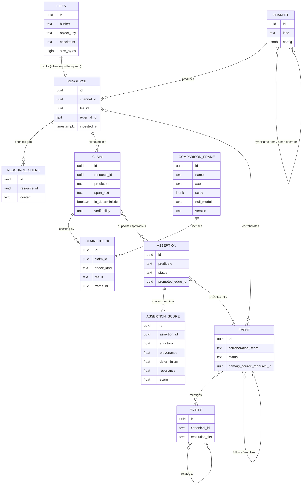

# World Model Ingestion — minimum ontology

Only CHANNEL, FILES, RESOURCE and RESOURCE_CHUNK exist today (`content.*` in
`schema.sql`); the rest is the target model, and the built claims layer is
`specs/claims/`.

## What each node means

- **CHANNEL** — where content comes from: an API pull config, a Telegram feed, or
  the content-upload endpoint. `kind` distinguishes pulled vs. pushed; a new source
  is a row, not a schema change.
- **FILES** — the Postgres-side pointer to an object in S3-compatible storage.
  Content lives in the object store, never in a `bytea` column; `FILES` is how a
  `RESOURCE` knows where its bytes are.
- **RESOURCE** — one unit of ingested content (a filing, a post, an uploaded file),
  always tied to the `CHANNEL` it arrived through and, for uploads, the `FILES` row
  backing it.
- **RESOURCE_CHUNK** — the embedded, searchable unit — what `ai-query-layer`'s
  `SEMANTIC` mode actually queries. A `RESOURCE` is chunked into many of these.
- **EVENT** — a detected real-world happening, corroborated by one or more
  `RESOURCE`s (scored by distinct source-*type* count, not raw count), always
  carrying a `primary_source_resource_id` back to the actual filing/record it
  derives from.
- **CLAIM** — one atomic assertion extracted from exactly one `RESOURCE`, carrying
  the verbatim span it came from. Immutable and never merged: this is *what a
  source said*, attributed, with contradictions preserved. `is_deterministic`
  records whether a parser or an LLM produced it — the two are not the same kind
  of object and nothing downstream may treat them alike.
- **CLAIM_CHECK** — one deterministic check result against one `CLAIM`
  (registry match, arithmetic, predicate conflict, …). `inconclusive` is a real
  result, distinct from `fail`.
- **COMPARISON_FRAME** — the declared manifold a check runs in: which axes two
  things share (time, the entity graph, space), at what scale, against what null
  model. Registered *before* use, never fitted after. Without one, an
  observational check cannot run at all — and that refusal is a real outcome, not
  a zero.
- **ASSERTION** — the deduplicated, cross-source thing many `CLAIM`s are *about*.
  Never authored directly. Promotes into the world model — an `aiq.edges` row, and
  an `EVENT` where the predicate is event-shaped — only once its score's lower
  bound clears the threshold on at least two independent sources.
- **ASSERTION_SCORE** — the fusion output, kept as a time series with its
  components stored separately rather than as one mutable number. The history is
  what makes convergence *shape* (and therefore coordinated-source detection)
  computable at all; the components are what make the score recalibratable,
  explainable, and auditable.
- **ENTITY** — a company/person/product/topic, resolved through the cost-cascading
  tiers (`resolution_tier` records which one succeeded), linked to the `EVENT`s
  that mention it and to other `ENTITY` rows it relates to.

`CLAIM` → `ASSERTION` → promotion is the staging area: **what we were told**,
kept separately from **what we believe**, so the pipeline can't destroy the
disagreement between sources on its way to an upsert.

## What's deliberately left off this diagram

The reputation/social graph, marketplace, and payout machinery from
the wider Percolate product — explicitly out of scope for this system (see brief §1).
This ontology is the data/detection graph only.

The Content Server itself (`brief.md` §3.5) is also left off — it's the service
that *writes* `FILES`/`RESOURCE` rows and the object-store bytes `FILES` points
at, not a data entity of its own.
